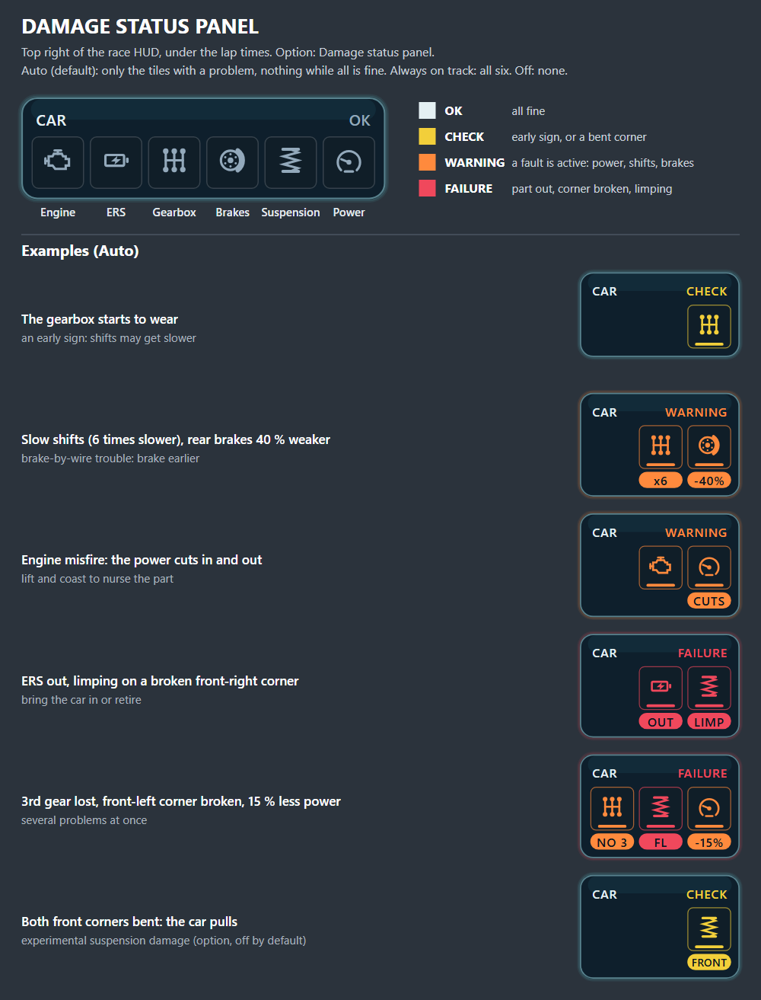

# Terminal Damage — F1 25 addon (Swofty) — beta

When your car breaks, F1 25 normally takes it away from you on the spot. With this addon you keep the car and deal
with the failure like a real driver: limp on, pull over or bring it to your box. On top of that come realistic
mechanical failures with warning signs, a damage HUD, engineer radio calls, FIA rules and garage repairs.

**Download:** install it from the Addon Browser in the Swofty Launcher, or get the zip from [Releases](../../releases) and import it.



## 0.75 beta

- **Presets:** Casual, **Realistic (default)** or Hardcore set the main options at once. The defaults are now the
  Realistic preset, so *Mechanical failures in Grand Prix* is Realistic (was Off) unless you set it yourself.
- **Realistic failures** at the real rate of the season you pick (2012-2026), often with warning signs first: power
  loss, cut-outs, slow shifts, a lost gear, rear brake trouble. AI cars break down too. Since 0.75.5 also in Career and
  My Team (experimental). Since 0.75.6 every team has its own rate, and in Career a team's finished Durability R&D
  lowers it ([failure factors per season](docs/team-failure-factors.md)).
- **Game settings:** the addon is built and tested with the game's own *Car Damage* and *Car Damage Rate* (Damage
  Settings) on **Simulation**.
- **Damage status panel** at the top right of the race HUD, and **engineer radio** calls with the game's own voice lines.
- **Crashes:** one broken corner, front or rear, may let the car crawl on; heavy aero or body damage keeps the drive
  and calls you in. **FIA rules:** in a race a car on a broken corner must stop; pit by the end of the next lap after a
  scripted failure or heavy damage.
- **Suspension damage from hits** is experimental and **off by default**. Since 0.75.3 it works together with
  Heavier Damage: while it is on, the game's own suspension damage stays at stock, so the two do not add up.
- **Something not working?** Every part has its own option: turn off only that part for now and send me your
  `loader.log` (newest folder in `%LOCALAPPDATA%\Swofty\sessions`) in an [issue](../../issues).

How it works, the HUD, every option and the known issues: [mod/README.md](mod/README.md).
All changes: [CHANGELOG.md](CHANGELOG.md).

## Addon integration

Spectator addons can use the versioned [player-state API](docs/player-state-api.md)
to observe retirement and recovery without polling game memory.

## Building

Needs [zig](https://ziglang.org/) 0.15 on PATH.

```
mod\native\build.ps1      # Windows
mod/native/build.sh       # Linux (cross-compiles the Windows DLL)
```

The DLL lands in `mod/native/`. Zip the contents of the `mod` folder (swofty.json at the zip root) to import it in the Swofty Launcher.

## License and attribution

**[Terminal Damage Attribution License 1.0](LICENSE)**, a custom license.
Published mods/projects using substantial portions must visibly show:

> Uses work from Terminal Damage by nyannoying

Include the [project link](https://github.com/nyannoying1337/f1-25-terminal-damage)
and preserve the copyright/license notices in redistributed copies. See LICENSE
for the complete terms. Earlier MIT releases retain their MIT terms.

The Swofty SDK files (`mod/native/include/swofty*`) retain their own licenses;
Terminal Damage's `terminal_damage_api.h` uses the project license.
