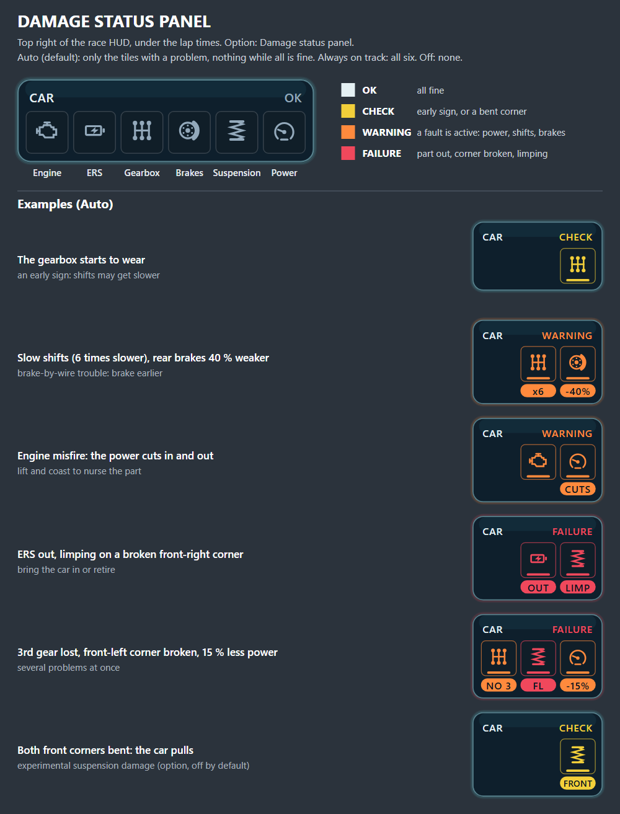

# Terminal Damage (Swofty addon for F1 25) — beta

When your car breaks, F1 25 normally takes it away from you on the spot. With Terminal Damage you keep it and deal
with the failure like a real driver: limp on, pull over or bring it to your box. On top of that come realistic
mechanical failures with warning signs, a damage HUD, engineer radio calls, FIA rules and garage repairs.

## New in 0.75.6

- **Failures per team:** each team's cars break down at that team's real rate in the season, and in Career a team's finished Durability R&D lowers it, about 1 % per upgrade (see Realistic failures).
- **Game settings:** the addon is tested with Car Damage and Car Damage Rate on Simulation (see Game settings).
- **Realistic failures work in Career and My Team too** (experimental, see Realistic failures).
- *Suspension damage from hits* works together with Heavier Damage (see Suspension damage from hits).
- The pause menu stops the failure clocks: no failure or warning sign moves on while the game is paused.
- Less work per frame in races with realistic failures.
- Realistic failures work with *Suspension damage from hits* off (the default); 0.75.3 gave none there.

## 0.75 beta: what is new

- **Presets:** Casual, Realistic (default) or Hardcore set the main options at once.
- **Realistic mechanical failures**, now on by default in Grand Prix and custom races: the real failure rate of the season you pick (2012-2026), often with warning signs first. AI cars break down too.
- **Damage status panel:** a new HUD panel at the top right shows what is wrong with your car (see The HUD).
- **Engineer radio:** your engineer calls out warning signs, failures, brake problems and broken corners with the game's own voice lines.
- **Crashes:** one broken corner, front or rear, may let the car crawl on; heavy aero or body damage keeps the drive and calls you in; the messages name the broken corner.
- **More FIA rules:** in a race a car on a broken corner must stop; after a scripted failure or heavy damage, pit by the end of the next lap or retire.
- **Garage repairs** in practice and qualifying count down properly, and a withdrawn car says so.
- **Suspension damage from hits:** new, experimental and off by default.
- Many fixes, among them flashbacks after heavy damage, the replay sound after a retirement and race restarts. Full list in the changelog.

**Updating from 0.51.85:** the defaults are now the Realistic preset, so *Mechanical failures in Grand Prix* is **Realistic** (was Off) unless you set it yourself. Options you changed before stay as they are, and the preset then shows Custom.

## Quick start

1. Steam version of F1 25 with Swofty Launcher 1.7.0 or newer. Install Terminal Damage from the Addon Browser, then restart the game.
2. In the game's own settings (Damage Settings) put **Car Damage** and **Car Damage Rate** on **Simulation** (see Game settings below).
3. A one-time message on the main menu points you to the preset. **Realistic** is the default: nothing else to set up.
4. Want it easier or harder? In the game: ADDON SETTINGS, Terminal Damage, **Preset**. Every option has a description there.
5. Optional: **Suspension damage from hits** is experimental and off by default (see below).

The game's UDP telemetry is not needed: SimHub, CrewChief and other telemetry apps keep port 20777. Made for offline sessions; you can load straight into a race.

## Game settings

Terminal Damage is built and tested with the game's own damage on **Simulation**. These two options are in the game's settings (Damage Settings), not in ADDON SETTINGS:

- **Car Damage: Simulation.** The game decides how much damage a crash does, and the limping, the broken corners, STOP THE CAR and the terminal damage rules all work on that damage. With Off there is no crash damage, so none of it can happen.
- **Car Damage Rate: Simulation.** How fast damage builds up.
- Reduced and Standard are not tested. If you use them and something looks wrong, tell me what you set.
- The random failures of *Mechanical failures in Grand Prix* are the addon's own (Realistic is the default). They come in races and sprints, not in practice or qualifying; the *Failure season* sets the real rates they follow.

## Presets

- **Casual:** no random failures in Grand Prix, 50 % power with a broken turbo or ERS part, the damage panel always on, the game's own red flag rules, a missed pit call means retired instead of disqualified, pause menu Retire ends your race at once.
- **Realistic (default):** real failure rates for the season, 30 % power, FIA red flag rules, disqualified for a missed pit call, damage panel on Auto, pause menu Retire asks you to pull over first.
- **Hardcore:** Realistic with 20 % power and no damage panel.
- **Custom:** change one of these options yourself and the preset shows Custom.

Picked in the game: reopen ADDON SETTINGS to see the changed options. Picked in the launcher: it applies at the next game start. A preset never changes hotkeys, the failure season, wheel physics, sounds, suspension damage or debug options.

## The HUD

**Damage status panel** (option *Damage status panel*): tiles at the top right of the race HUD, under the lap times. The header shows the worst state: OK, CHECK (yellow), WARNING (orange) or FAILURE (red).

- **Six tiles:** engine, ERS, gearbox, brakes, suspension and power, each coloured by how bad it is.
- **Yellow:** an early sign, such as a gearbox starting to wear, or a bent corner.
- **Orange:** a fault is active: less power, slow shifts, a lost gear, brake trouble or a weakened corner.
- **Red:** the part is out, a corner is broken, or you are limping.
- **The label under a tile:** OUT (failed), -15% (power lost), CUTS (power cutting in and out), x6 (shifts 6 times slower), NO 3 (3rd gear lost), -40% (rear braking lost; + means the rear brakes grab), FL, FRONT or ALL (which corners), LIMP (crawling on a broken corner).
- **Auto** (default) shows only the tiles with a problem, so nothing is shown while all is fine. **Always on track** shows all six, **Off** none. The panel goes away once your race is over.

**Messages** in the middle of the screen tell you what happened and what to do next: SUSPENSION DAMAGE, BROKEN FRONT CORNER, WHEEL LOST, MECHANICAL FAILURE, BRAKE FAILURE, HEAVY DAMAGE, STOP THE CAR, DISQUALIFIED, CAR WITHDRAWN, CORNER REPAIR, CAR REPAIRED and more. Messages titled ENGINEER give advice, for example "the rear brakes are grabbing, bias forward".

**Engineer radio** (option *Engineer radio for damage and failures*): the same events as voice calls. Off: only the messages stay.

**Damage MFD page:** with the experimental suspension damage on, the game's own damage page shows the damaged corners (the stock page shows them as tyre wear).

## What happens when something breaks

- **Engine (ICE) or gearbox:** no drive; the car rolls out.
- **Turbo, MGU-K, MGU-H, battery or control electronics:** reduced power (30 % throttle in Realistic; option *Power with a broken turbo/ERS part*).
- **A crash that breaks a corner:** the car usually cannot be driven. With **one** broken corner it may still crawl on with about a third of its power: a collapsed suspension 85 % at the front and 60 % at the rear, a front wheel coming loose 35 %. Never once the game tears the wheel off: that also stops the engine.
- **Race, crawling on a broken corner:** STOP THE CAR. Pull over as soon as it is safe, or get to the pit lane. After 20 s of driving on track the car retires as unsafe.
- **Practice and qualifying, crawling on a broken corner:** bring it back to the garage for a rebuild.
- **Heavy aero or body damage** that the game calls terminal (front wing, sidepods, floor, rear wing, diffuser): the car keeps its drive. Race: pit by the end of the next lap or retire. Practice and qualifying: back to the garage, out for the session.
- **Engine sound:** a failed engine goes silent at once; after terminal crash damage the engine dies after 3-6 s; a broken car standing still switches off after 6 s.
- Your stopped car brings out no safety car or red flag.

## Realistic failures (Grand Prix, custom races and Career)

- *Mechanical failures in Grand Prix*: **Realistic** (default) uses the real failure rate of the season in *Failure season* (2012-2026; pick your car mod's season). Short races have fewer failures, and practice and qualifying none. Also: a fixed chance (10-50 %) or Off.
- Many failures give **warning signs** first: power loss, cut-outs, slow or rough shifts, a lost gear, rear brake trouble. **Lift and coast** to nurse the part: it lasts longer.
- Some faults stay partial: slow shifts, a missing or jammed gear, DRS, ERS or lean fuel trouble, a rear brake-by-wire fault (from 2014).
- AI cars break down at the season's rate too.
- **Each team has its own rate** (new in 0.75.6): a team's cars break down as often as that team's did in the season, from its real retirements, so in 2026 an Aston Martin or a Cadillac fails far more often than a Mercedes (Cadillac about 1 race in 3.6 per car, Aston Martin about 1 in 2.6). The season's overall rate stays the same: the rates of the cars in your race add up to it, whichever teams are on the grid. A team's rate is pulled towards the season's average when its numbers are few, and in a year where the teams hardly differed (2023-2025, and so the default season 2025) the rates are nearly equal. A team the addon does not know gets the average. The log lists the teams it found and their rates. Every team in every season: [team failure factors](https://github.com/nyannoying1337/f1-25-terminal-damage/blob/main/docs/team-failure-factors.md).
- **Career R&D matters** (new in 0.75.6): every team starts a Career with the same five *Durability* upgrades done; each further finished one takes about 1 % off that team's failure rate, up to half with all of them done. It counts for you and for the AI teams (the game researches theirs during the season), and only for the team that did the research: when you research, the AI cars do not get worse, and a grid that develops fails less as the season goes on. A research that fails does not count (the same upgrade can be started again). Option *R&D durability lowers failures (Career)*, on by default. At the start of a Career nothing changes.
- **Career and My Team** get them too (new in 0.75.5, experimental: only short tests so far): with Realistic on, they replace the game's own rolled failures and its temporary fault for your car, so the real team rates and the teams' Durability R&D decide who breaks down, not the game's own model. The AI cars keep the game's temporary faults.

## Retirement

- **Pull over:** stand still for 10 s, on track or stranded in the pit lane.
- **Your pit box (race):** no tyre stop; your crew pushes the car into the garage, then you retire.
- **Retire without damage:** radio menu Retire, pause menu Retire or Ctrl+Shift+F11, then pull over or box. The hotkey cancels the request while you are still on track.
- After retiring, the parked car stays where it is instead of the AI driving it away.
- **Flashbacks:** back before the damage, the car is whole again with full power.

## Red flags (FIA rules)

- A failed engine, power unit or gearbox, or a car left on track without drive: you retire.
- A car limping on one broken corner may be rebuilt during the red flag (80 % for a suspension, 50 % for a lost wheel) and take the restart. Heavy aero or body damage may be repaired too.

## Practice and qualifying

- Retiring would end the whole session, so your car goes back to its garage instead.
- **Limped in on a broken corner:** the team rebuilds it, 20-30 minutes for a suspension and 30-45 for a lost wheel. The game's repair timer counts down: wait, or use skip or fast forward (uses session time).
- **A damaged corner that still holds** (experimental suspension damage): 4-20 minutes, by how bad it is.
- **Did not make it back** (stopped on track, or Retire from Session): withdrawn for the rest of the session, ready again in the next one.
- **Engine or gearbox failure in Career:** the car stays in the garage until you fit a new part in the Power Unit menu.

## Career and My Team (experimental)

- Realistic failures work here too (see above). With the option on Off, the game's own failure chances and timing stay unchanged; a fixed chance adds to them.
- When the game would hand your car to the AI after a failure, you keep it: pit by the end of the next lap or retire, otherwise you are disqualified (or retired, see the options). A DSQ stays DSQ in the results.

## Suspension damage from hits (experimental, off by default)

Turn on *Suspension damage from hits (experimental)*, then restart the game.

- A clear hit on a wheel can bend that corner (the car pulls to one side), weaken it, leave a hidden crack that lets go later, or break it. Scrapes, boards and normal kerbs do not break a healthy corner.
- A badly damaged corner can collapse within seconds to a few minutes of driving, usually over a kerb.
- With it on, the game tears a wheel off only in big crashes; moderate hits end in a bent or broken corner instead.
- Shown on the damage panel and the game's damage MFD page; repaired in the practice and qualifying garage; undone by a flashback.
- **Using Heavier Damage?** They work together: while this option is on, the game's own suspension damage stays at stock on the cars it covers (your car; every car with the AI option), so Heavier Damage's *Suspension & wheel damage* does not add up with it. Heavier Damage's wing damage and its other settings stay.
- *Suspension damage for AI cars* is a separate experimental option.

## Something not working?

Every part has its own option. Turn off only the part that gives you trouble for now, keep the rest, and send me your log so I can fix it. Some options need a game restart; their description says so.

- **Random failures:** *Mechanical failures in Grand Prix*: Off.
- **Damage panel:** *Damage status panel*: Off.
- **Radio calls:** *Engineer radio for damage and failures*: off.
- **Suspension damage:** *Suspension damage from hits*: off (the default).
- **Retire in the menus:** *Retire in the radio menu* or *Retire in the pause menu: pull over first*: off.
- **Red flag rules:** *FIA red flag rules for a terminally damaged car*: off.
- **Career failures:** *Keep control after a scripted failure*: off.
- **Everything:** *Keep control after terminal damage*: off gives you the game's own behaviour.

**Your log:** loader.log in the newest folder of %LOCALAPPDATA%\Swofty\sessions (while the game runs: the swofty folder inside your F1 25 folder). Post it in the Terminal Damage discussion on OverTake or open an issue on [GitHub](https://github.com/nyannoying1337/f1-25-terminal-damage/issues), and say what happened and roughly when: session type, track, flashback or restart.

## Other options

- **Player wheel behavior:** Stock (default), Reduced jolting (experimental) or Loose wheels. **Loose AI wheels** is separate and off. Restart the game after changing either.
- **Debug options** are at the bottom of the list and off. Leave them alone unless I ask you to test something.

## Known issues (beta)

- The Career R&D effect is small (about 1 % per Durability upgrade) and its cap of half with every upgrade done is a first guess: I will tune it once I have seen how fast the AI teams research.
- Suspension damage is experimental: its tuning can still change.
- Career is not fully tested with the limping, red flag and garage repair rules yet. The realistic failures there (0.75.5) are new: one from the real rates has not been seen in a Career race yet (the test setting has), and in Career an AI car that fails stayed where it stopped for about two minutes before the game took it to its garage.
- No safety car HUD while your car is terminally damaged: the game shows it only to cars it does not count as terminally damaged.
- A red flag during terminal damage can still cause AI or spectator camera issues.
- AI cars with terminal damage can stop at the pit exit or on track.
- A flashback during the box stop or the garage push is not fully tested in game.
- **Qualifying ICE replacement, Skip repairs and practice replacement timing: NOT TESTED, MIGHT BE BROKEN.**
- A game update can switch parts of the addon off until it is updated.
- Hiding pit equipment does not establish that all associated collision is removed.
- Career part swap: the swap is checked when you leave the garage; without a new part the car can briefly reach
  the pit exit before it returns.
- No safety car or red flag for your own stopped car: unlike real race control, it retires after 10 s.

Radio Retire is last in the four standard command lists. Swofty manages replacement of
speech_recognition.xml; another mod replacing it can conflict. No experimental file overlay
is required. Radio menu retirement disables the native action; Retirement radio voice chooses
voice/silent XML after restart. A repeated selection can request speech again. Other retirement
routes do not add a voice reply. Disable the addon to remove its command-file operation.

## Reporting problems

Send the `loader.log` from the newest folder in `%LOCALAPPDATA%\Swofty\sessions\` (the launcher moves it there when
the game closes; while the game runs it is `<F1 25 folder>\swofty\loader.log`). Include the session type, track, car,
what happened before the failure, and whether you used a flashback or a restart. For a retirement problem, say whether
the car was fully on track or still in the pit lane. For a pit problem, mention a teammate stop.

Full changes: [CHANGELOG.md](https://github.com/nyannoying1337/f1-25-terminal-damage/blob/main/CHANGELOG.md).

## License and reuse

**Terminal Damage Attribution License 1.0**, see LICENSE. Published mods/projects
using substantial portions must visibly show **Uses work from Terminal Damage by
nyannoying** and link to https://github.com/nyannoying1337/f1-25-terminal-damage.
Redistributed copies must retain the copyright and license notices. See LICENSE
for the complete terms. Earlier MIT releases retain their MIT terms.
Third-party SDK files retain their own licenses; terminal_damage_api.h uses the
Terminal Damage project license.
